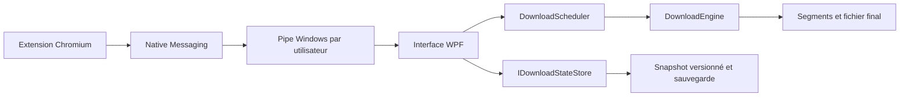

# Fondations de SwiftFetch — jalon 0.4

Cette page décrit le jalon 0.4. Le [jalon 0.5](MILESTONE-0.5.md) ajoute la segmentation dynamique, remplace le stockage principal JSON par SQLite, et introduit les sessions protégées.

Le [document fourni](master-feature-inventory.md) est l'inventaire du produit cible. Il ne représente pas une liste de fonctionnalités déjà livrées. Ce jalon met en place un premier socle fonctionnel et testable pour poursuivre ce produit.

## Architecture en place

L'interface reçoit les commandes, le scheduler gère les places disponibles, et le moteur gère les transferts. Les commandes du scheduler sont appelées sur le dispatcher de l'application ; les tests utilisent aussi ses protections de concurrence. Une interface de stockage permet de remplacer l'implémentation JSON sans réécrire la file ni le moteur.

## Fonctionnalités de ce jalon

| Domaine | Livré |
|---|---|
| États | Modèle interne typé, états de reprise, attente, vérification et erreurs détaillées |
| Métadonnées | URL initiale/finale, MIME, code HTTP, dates, catégorie, queue, compte de reprises |
| Connexions | 1, 2, 4, 8 ou 16 ; repli à une connexion quand les plages ne sont pas utilisables |
| Reprises automatiques | Erreurs réseau, flux interrompus, HTTP 408/429/500/502/503/504 ; délai exponentiel borné et Retry-After borné |
| Erreurs permanentes | Authentification, fichier absent/expiré, protocole, permissions, disque et intégrité distingués ; espace libre contrôlé avant les transferts quand le volume est interrogeable |
| File d'attente | FIFO Default ; nombre de téléchargements actifs limité, réglable de 1 à 16 |
| Commandes | Pause/reprise individuelle, Pause all, Resume all, sauvegarde pour plus tard |
| Préférences | Dossier, connexions par défaut, limite de téléchargements et reprises sauvegardés |
| Sauvegarde | Migration de l'ancien tableau JSON ; snapshot versionné, remplacement atomique, backup et récupération |
| Reprise des segments | Plages et validateurs enregistrés avant transfert ; octets validés après flush ; fragments non enregistrés écartés |
| Intégrité | SHA-256 attendu facultatif ; comparaison avant publication du fichier final |
| Catégories | Classification automatique de base par extension, visible sous le nom |
| Navigateur | Chrome/Brave existants conservés ; pas de changement du contrat du bridge |

Les paramètres se trouvent dans **Settings**. **Options** sous le lien permet d'enregistrer pour plus tard et de fournir un SHA-256. Les téléchargements qui dépassent la limite affichent **Queued**. Un téléchargement en attente ne consomme pas de connexion réseau.

## Contrats de reprise et de stockage

- Les segments gardent leurs plages, le validateur distant et `CommittedBytes`. Un segment est flushé périodiquement et en fin de transfert/interruption. Les octets au-delà du dernier checkpoint sauvegardé sont écartés à la reprise ; cela peut redemander une petite fin de segment.
- Le moteur demande une sauvegarde des métadonnées avant d'écrire les segments. Si cette sauvegarde échoue, il arrête le transfert. Les fragments sans métadonnées sont supprimés uniquement pour l'identifiant de cette tâche.
- Le serveur est contrôlé à chaque tentative. Un changement de taille/ETag/Last-Modified impose un redémarrage sûr. Sans validateur utilisable, un téléchargement partiel repart du début.
- Les snapshots restent dans `%LOCALAPPDATA%/SwiftFetch/history.json` avec `.bak`. Une sauvegarde corrompue est conservée ; si un backup valide existe, il est utilisé. Si aucune sauvegarde ne peut être chargée, l'ajout de tâches est bloqué pour ne pas écraser l'historique.
- Les tâches qui étaient actives ou en attente rouvrent en pause. Elles ne commencent pas à télécharger automatiquement après le démarrage de Windows.
- Un hash incorrect laisse les segments disponibles, mais ne publie pas de fichier final. Une erreur d'intégrité n'est pas relancée automatiquement.
- Les nouveaux champs ne contiennent pas de cookies ni de mots de passe. Les URL signées restent des informations sensibles dans l'historique, comme auparavant.

## Suite de la feuille de route

| Jalon | Travail restant |
|---|---|
| M2 — moteur avancé | Segmentation dynamique, réduction automatique des connexions refusées, règles par hôte, limiteur de débit, tests sur vrais serveurs et coupures réseau |
| M3 — persistance et files | SQLite transactionnel derrière IDownloadStateStore, files nommées/priorités, planification, gros historiques, récupération de publication interrompue et qualification des coupures de courant |
| M4 — authentification | Cookies par domaine, référent/user-agent, secrets DPAPI, login/proxy, URLs expirées et renouvellement |
| M5 — expérience Windows | Dialogue de création complet avec prévisualisation des métadonnées, propriétés détaillées et segments, import/export/batch, tray, notifications, langues FR/EN/AR et RTL, thèmes |
| M6 — médias | Médias directs puis HLS/DASH non protégés, FFmpeg, pistes et qualité |
| M7 — distribution | Installation signée, mises à jour signées, diagnostic sans secrets, CLI/API authentifiée, Site Grabber séparé |

SQLite, la segmentation dynamique, le planificateur, les cookies, FTP et le téléchargement de vidéos depuis une page ne sont pas implémentés dans ce jalon. La liste complète reste conservée dans l'inventaire.

## Validation

Tests ciblés : intégrité des segments existants, reprise après historique sérialisé, filename/Unicode, reprises temporaires et erreurs permanentes, annulation pendant attente, SHA-256 valide/invalide, checkpoint avant écriture, fragments orphelins, migration/backup/corruption/version de stockage, FIFO et limite de concurrence, arrêt de la queue, intégration du bridge et rendu WPF.

Ces tests valident les scénarios automatisés, pas une certification de production ni une garantie matérielle contre toutes les coupures électriques. Les profils réels de serveur, les changements de VPN, la pression disque et les grands historiques doivent être qualifiés aux jalons suivants.
